# Portage Subsonic — spike

Ce dépôt est un fork de [Myspoti](https://github.com/kota-zo/myspoti) (GPL-3.0) dont le
backend Spotify a été remplacé par un backend **Subsonic/OpenSubsonic** pour Jellyfin/Navidrome.

> **Licence** : ce fork reste sous **GPL-3.0**. Il conserve `LICENSE`, les en-têtes de
> copyright et la notice d'origine. Toute distribution doit fournir le code source complet
> sous GPL-3.0, conserver ces notices et créditer Myspoti. Voir `AGENTS.md`.

## Ce que fait le spike

| Surface | État |
|---|---|
| Démarrage sans login Spotify | Oui : `MyspotiRuntime.startSubsonic(...)`, le WebView n'est pas démarré |
| Configuration serveur | Oui : écran natif au premier lancement + dialog depuis Settings / menu profil |
| Authentification | Token Subsonic `u`/`t = md5(password + salt)`/`s` |
| Menu profil | Oui : Settings / Server / About (plus d'entrées Spotify ni de « Log out ») |
| Settings | Oui : serveur, apparence, à propos ; onglets Downloads/Extensions masqués |
| Filtres Home | Oui : All / Music seulement (pas de podcasts/audiobooks) |
| Onboarding | Oui, **une seule séquence** : serveur Subsonic (étape 1) → look (Immersive/Classic) → permissions ; étapes Spotify (intro/qualité/extensions) sautées |
| Menu profil | Oui, Classic et Immersive : Settings / Server / About |
| Sortie audio | Oui : « This phone » local ; plus de liste Connect ni de sonde qualité Spotify |
| Look | Oui : **Immersive par défaut** (celui du README) ; Classic dans Settings → Display → Look |
| Home | Oui : quick tiles (playlists/albums + Liked Songs) puis nouveautés, souvent écoutés, playlists |
| Search | Oui : `search3` (morceaux/albums/artistes) + genres pour « Browse all » |
| Library | Oui : artistes, albums, playlists |
| Album | Oui : `getAlbum`, gradient, liste des morceaux |
| Artist | Partiel : `getArtist`, albums, top morceaux approximatif |
| Lecture & MediaSession | Oui : ExoPlayer (audio focus, noisy, wake lock réseau) + `PlaybackService` (`MediaSession`, notification, écran verrouillé, boutons casque) |
| Persistance file & Scrobble | Oui : `savePlayQueue` / `getPlayQueue` + `scrobble` (`nowPlaying` et `submission=true` à 50% / 4 min) |
| Playlists (CRUD) | Oui : lecture, création (`createPlaylist`), renommage/description (`updatePlaylist`), ajout/retrait de titres (`songIdToAdd`/`songIndexToRemove`), suppression (`deletePlaylist`) |
| Artiste | Oui : `getArtist`, `getTopSongs`, `getArtistInfo2` (biographie, images, artistes similaires) |
| Paroles | Oui : OpenSubsonic `getLyricsBySongId` (synchronisées ou texte) + fallback `getLyrics` + fallback LRCLIB |
| Téléchargements / hors ligne | Oui : le serveur sert lui-même le fichier (`stream`, original ou transcodé), file `OfflineDownloader` + WorkManager (notification de progression), fichiers chiffrés ; hors ligne, seuls les titres téléchargés jouent (bandeau + message pour les autres) |
| Stockage | Oui : téléchargements (nombre/taille), cache + vider, espace libre, tout supprimer |
| Partage | Oui : feuille de partage Android native (`titre — artiste`), sans Spotify Code ni lien `open.spotify.com` |
| Podcasts, Connect, Jam, Blends, Canvas, Genius, extensions, pubs/DRM | **Désactivés / stubs** |

Le lecteur est un simple `ExoPlayer` dans le module `:api-subsonic` ; il n'y a plus de
WebView, de DRM Widevine ni de blocage de pubs.

Vérifié sur appareil réel : **OnePlus CPH2207, Android 13**, via ADB sans fil et
`adb reverse` vers Navidrome. Home, profil, Settings, album, lecture, player et feuille de
sortie locale fonctionnent sans crash. Les téléchargements (file + WorkManager), la
reprise après redémarrage, la lecture hors ligne (serveur injoignable), le bandeau
« Offline » et l'écran Stockage ont aussi été vérifiés. Podcasts/audiobooks sont désactivés
(`Features.PODCASTS = false`) et une URL sans schéma est normalisée en `http://`.

## Architecture du portage

- `api-subsonic/` : module Android du backend.
  - `SubsonicApi` implémente `MyspotiApi` (le contrat que toute l'UI Myspoti utilise déjà).
  - `SubsonicClient` : OkHttp + JSON, auth Subsonic `u/t/s` (token, pas de mot de passe dans l'URL).
  - `SubsonicBackend` : `Home`, `Search`, `Catalog`, `Library`, `Playlists`, `Users` + stubs.
  - `SubsonicPlayer` : `app.myspoti.api.Player` au-dessus de Media3 `ExoPlayer`.
- `MyspotiRuntime` : ajoute `startSubsonic(...)` et `isSubsonic` ; `api` renvoie le backend
  Subsonic quand il est actif, sinon Spotify.
- `Graph.init` : démarre Subsonic à la place du Web Player.
- `MainActivity` : saute le login WebView en mode Subsonic.
- `SongPlayer` : en mode Subsonic, ne branche que les flux `player.state` / `player.queue`
  (pas de Connect, pubs, DRM, watchers Spotify).
- `AndroidManifest.xml` : `usesCleartextTraffic="true"` pour un serveur LAN en HTTP.

Les URI internes restent au format `spotify:track:<id>` / `spotify:album:<id>` : ce sont
des identifiants opaques pour l'UI Myspoti. Un nettoyage ultérieur peut les passer en
`subsonic:...`.

## Lancer

```bash
printf 'sdk.dir=/home/adlen/android-sdk\n' > local.properties
JAVA_HOME=/home/adlen/tools/jdk-17.0.20.1+1 ./gradlew :app:assembleDebug
adb install -r app/build/outputs/apk/debug/app-debug.apk
adb shell am start -n com.adlen.jellyfinaudio.dev/app.myspoti.MainActivity
```

Le serveur se configure dans l'app :

1. Au premier lancement, l'écran **« Connect to your server »** demande l'URL, l'utilisateur
   et le mot de passe.
2. **Connect** fait un `ping`, sauvegarde dans les SharedPreferences `subsonic` et recharge
   l'app.
3. Pour changer de serveur plus tard : **Settings → icône nuage** (en haut à droite) ou **menu profil → Server**.

L'authentification utilise le token Subsonic (`u`, `t = md5(password + salt)`, `s`), donc
le mot de passe n'apparaît pas dans les URLs. Le client est dans
`api-subsonic/src/main/kotlin/app/myspoti/subsonic/` ; `SubsonicSettings` garde la
configuration.

Exemples d'URL :

- Jellyfin + Subfin : `http://<host>:8096/subfin/`
- Navidrome : `http://<host>:4533/`
- Émulateur Android vers l'hôte : `http://10.0.2.2:4533/`

## Prochaines étapes (pour un vrai port)

1. ~~Écran de configuration serveur + auth par token~~ ✅ (M1).
2. Remplacer/retirer les écrans et le code Spotify-only (Connect, Jam, Blends, podcasts,
   Canvas, Genius, extensions, pubs, DRM) — ils restent dans ce fork.
3. MediaSession + notification + lecture en arrière-plan (le spike n'a qu'un ExoPlayer
   en processus).
4. CRUD playlists, favoris, downloads/offline. ✅ (M4/M5)
5. Renommer le package et retirer toute marque/asset Spotify avant distribution.
6. Tests : contrats Subsonic, mapping, player, écrans principaux.

## Captures

> Les captures montrent le look **Immersive** (celui du README) avec la bibliothèque de
> test. Le look se change dans **Settings → Display → Look**.

| Home | Search | Library |
|:---:|:---:|:---:|
| 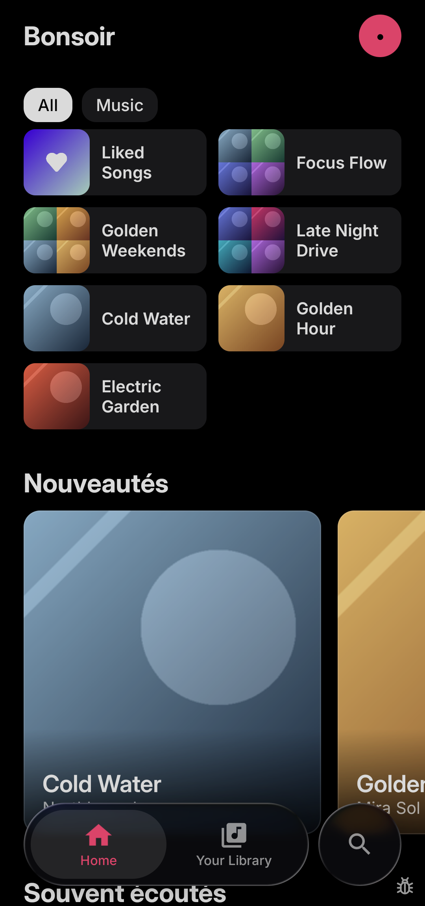 | 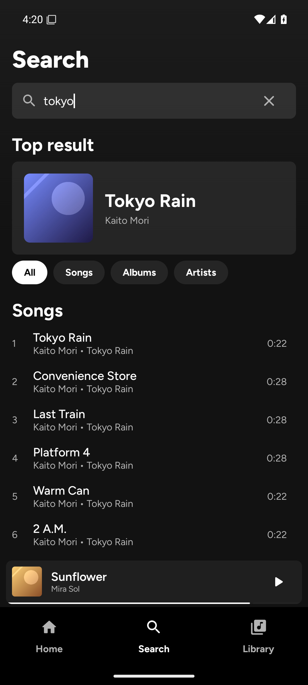 | 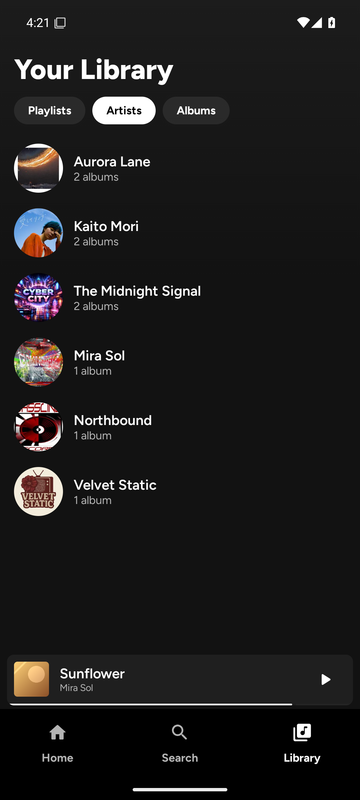 |

| Album | Player |
|:---:|:---:|
| 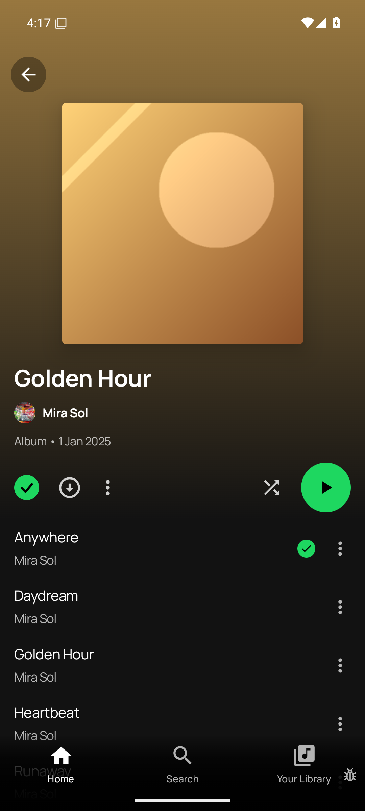 | 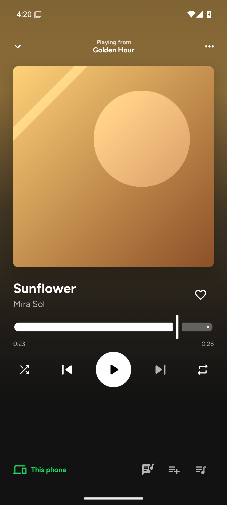 |

| Album | Player | Output |
|:---:|:---:|:---:|
|  |  | 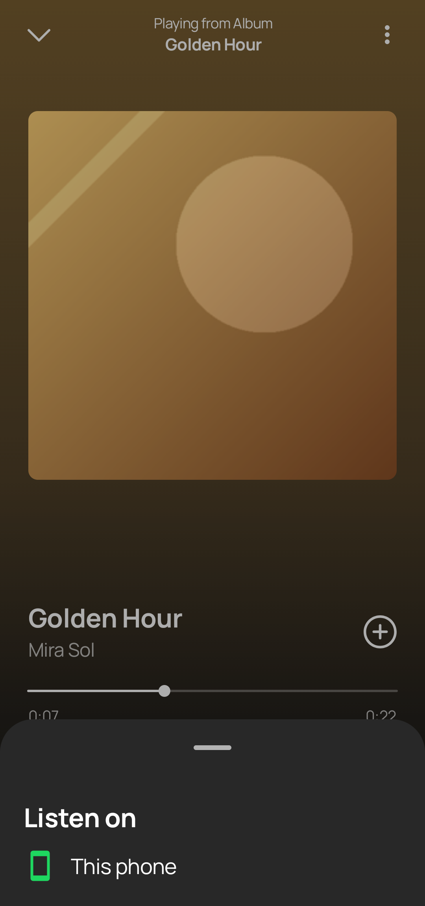 |

| Onboarding server | Onboarding look | Onboarding permissions |
|:---:|:---:|:---:|
| 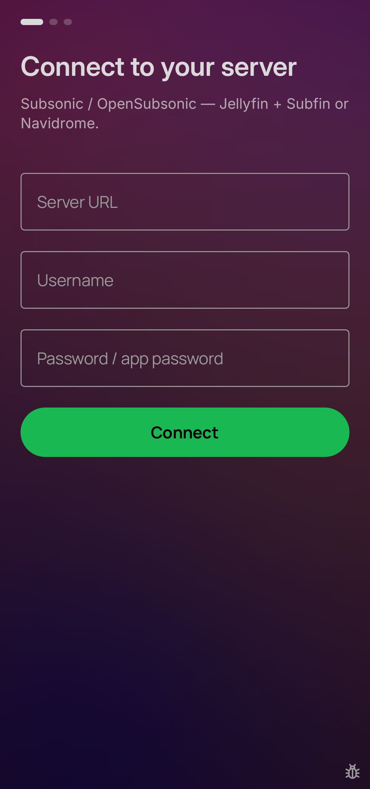 | 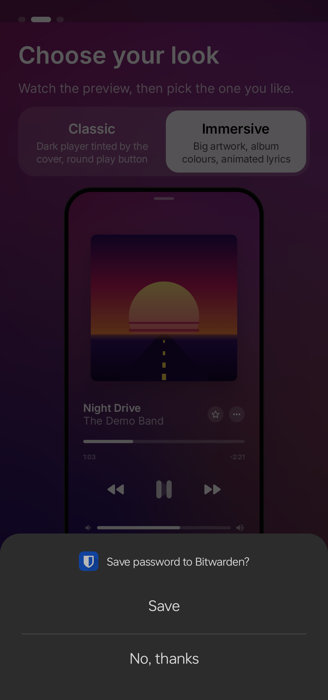 | 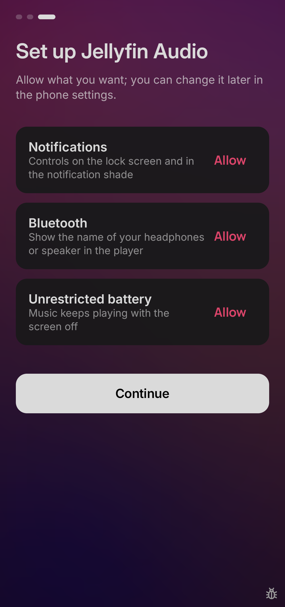 |

| Setup | Server dialog | Settings |
|:---:|:---:|:---:|
| 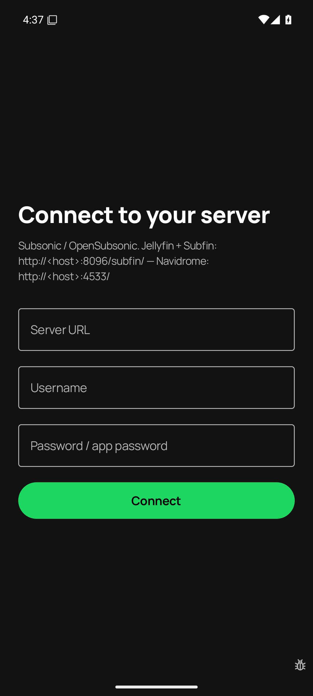 | 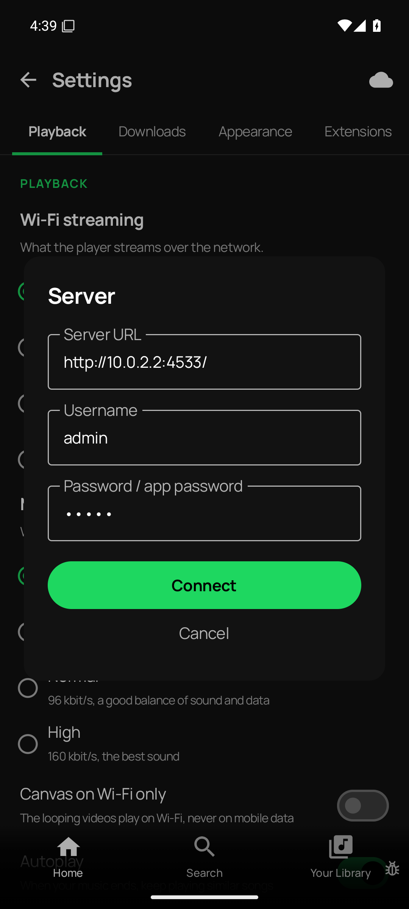 | 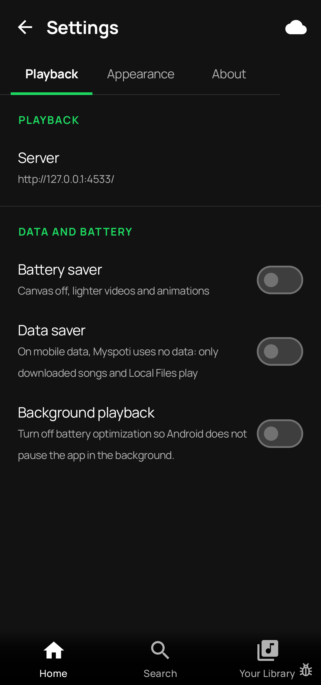 |

| Profile menu |
|:---:|
| 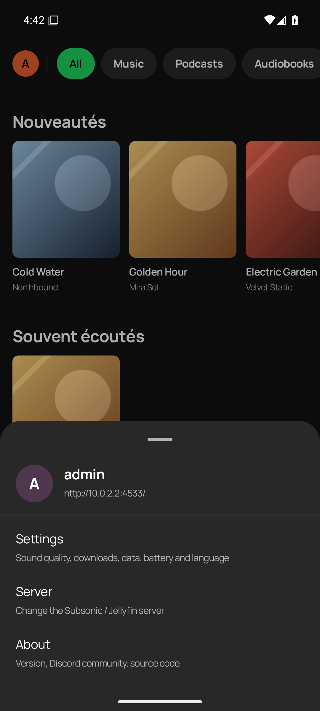 |
