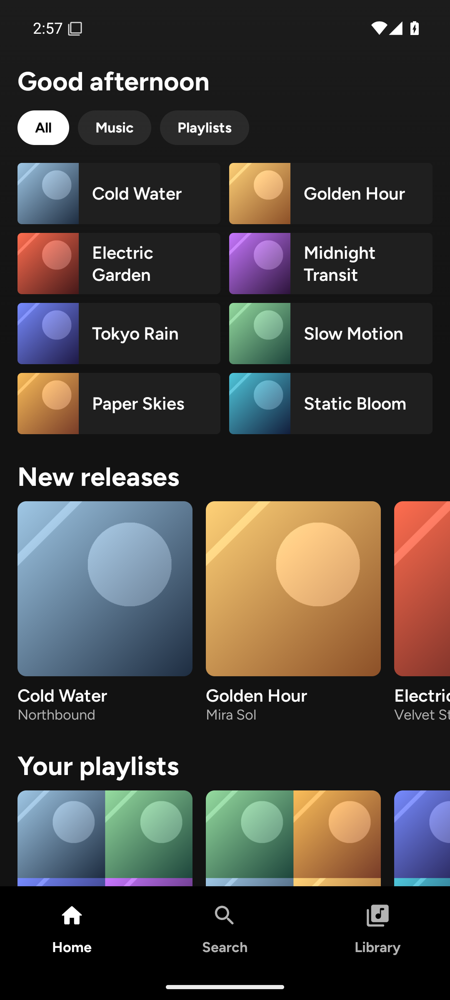
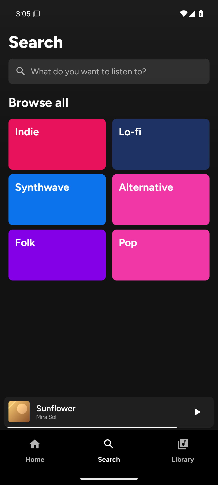
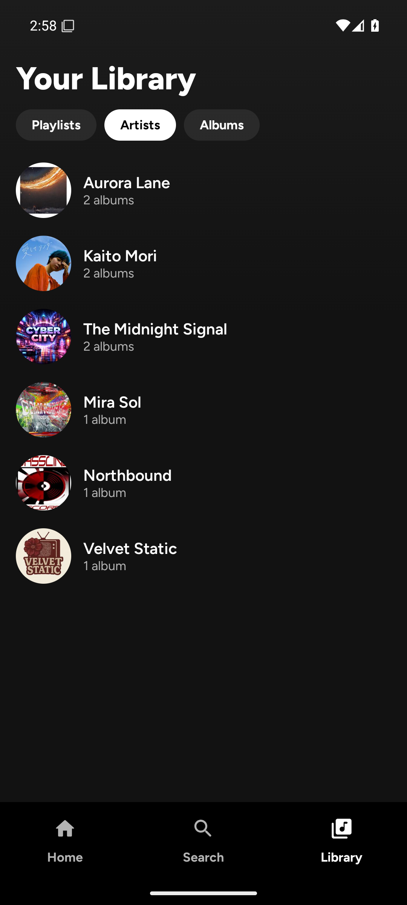
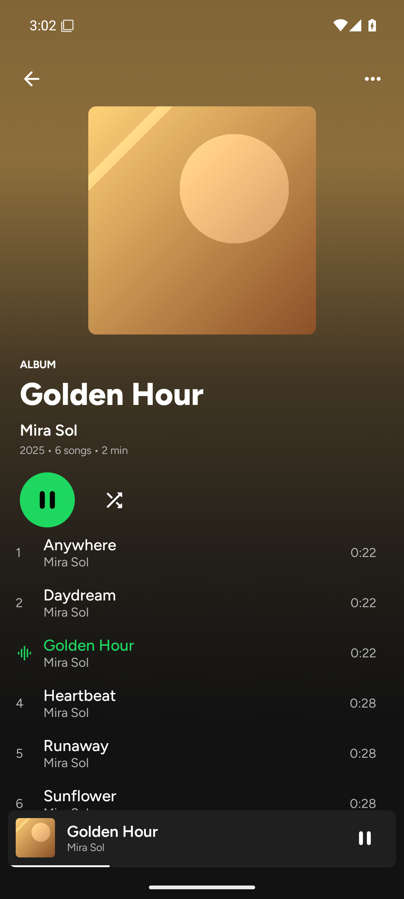
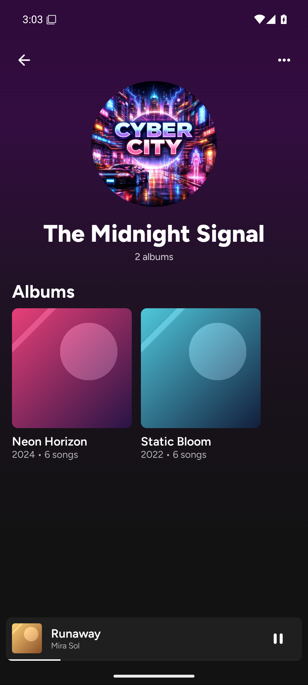
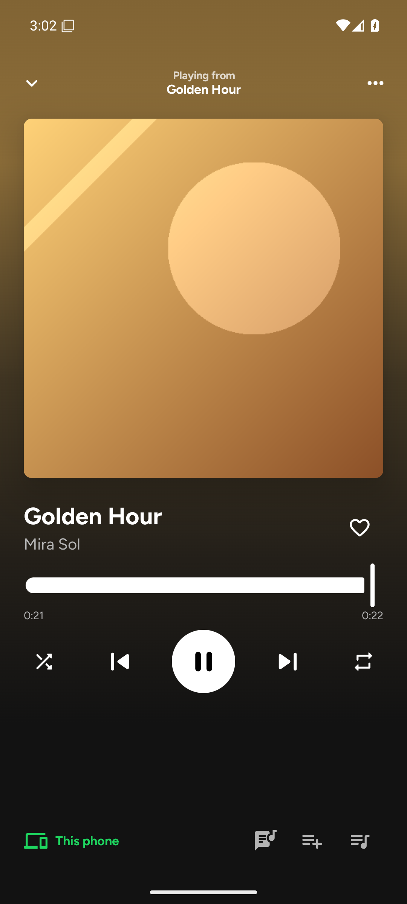
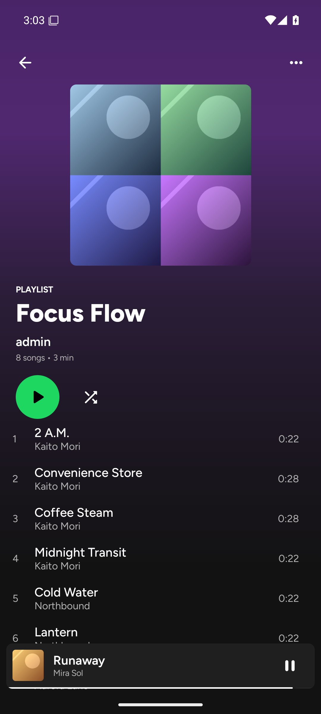
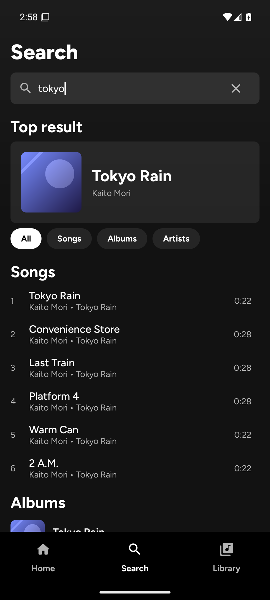
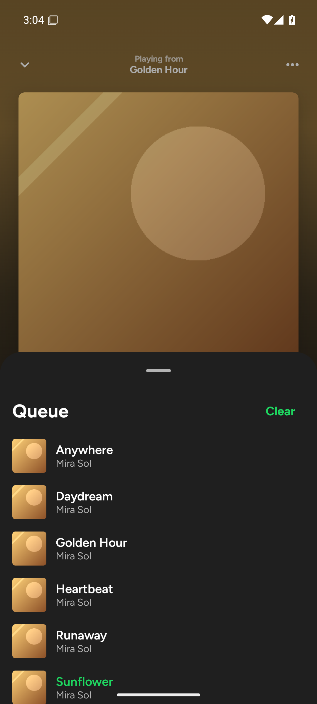

# Jellyfin Audio

An original Android music client inspired by Spotify's core experience, backed by
the **Subsonic / OpenSubsonic** API and optimized for **Jellyfin**.

> **License: GPL-3.0.** This repository also contains a fork of
> [Myspoti](https://github.com/kota-zo/myspoti); attribution and third-party notices are
> in [`THIRD_PARTY_NOTICES.md`](THIRD_PARTY_NOTICES.md), and the shared license text is
> in [`LICENSE`](LICENSE). The plan is in [`ROADMAP.md`](ROADMAP.md).

## Two clients in this repository

| Path | What it is | Build |
|---|---|---|
| `app/` | The original lightweight Compose client described below. | `./gradlew :app:assembleDebug` |
| `myspoti/` | A GPL-3.0 fork of Myspoti with a Subsonic backend (ported UI, in progress). | `cd myspoti/base && ./gradlew :app:assembleDebug` |

The fork reuses Myspoti's UI and replaces its Spotify Web Player with Subsonic +
Media3. See [`myspoti/PORTING.md`](myspoti/PORTING.md) for what works and what is still
stubbed.

- Reverse-engineering dossier:
  [`docs/reverse-engineering/spotify-9.1.92.md`](docs/reverse-engineering/spotify-9.1.92.md)
- Architecture and API mapping:
  [`docs/architecture/subsonic-client-blueprint.md`](docs/architecture/subsonic-client-blueprint.md)
- UI fidelity, free assets, and Subsonic content replacement:
  [`docs/architecture/ui-content-mapping.md`](docs/architecture/ui-content-mapping.md)

## Screenshots

Captured from the debug build against a local Navidrome server.

| Home | Search | Library |
|:---:|:---:|:---:|
|  |  |  |

| Album | Artist | Now Playing |
|:---:|:---:|:---:|
|  |  |  |

| Playlist | Search results | Queue |
|:---:|:---:|:---:|
|  |  |  |

## Current status

This is the first vertical slice (M0/M1 in the blueprint):

- **Spotify-style UI system**: Encore dark tokens and Figtree type scale,
  artwork-derived gradients, quick-pick tiles, a Browse-all genre grid, gradient
  album/playlist headers, an artist page, and an animated full-screen player with
  swipe-down dismissal and drag-to-seek.
- Server setup with Subsonic token auth (`ping`).
- Home with New releases (`getAlbumList2?type=newest`), Most played
  (`type=frequent`), Your playlists (`getPlaylists`), Favorite albums/artists
  (`getStarred2`), and Genres (`getGenres`).
- Library screen with artists (`getArtists`).
- Search (`search3`) for artists, albums and songs.
- Figtree (OFL) typography, rounded Material icons, Spotify-like design tokens.
- **Media3 playback**: `MediaSessionService` with ExoPlayer, audio focus, noisy
  handling, media notification, background playback.
- **Album/playlist detail** with a track list and Play action.
- **Real mini player**, full **Now Playing** screen, seek bar, shuffle/repeat,
  and a **queue bottom sheet**.
- **Favorites**: star/unstar the current song; the heart reflects server state.
- **Scrobbling**: now-playing and submission scrobbles at the 50%/4-minute
  threshold.
- **Play queue persistence**: restores `getPlayQueue` on startup and saves with
  `savePlayQueue` while playing.
- **Lyrics**: OpenSubsonic `getLyricsBySongId` with `getLyrics` fallback, plus a
  synced-lyrics screen with current-line highlighting.
- **Playlist add/create**: add the current song to an existing playlist or
  create a new one from Now Playing.
- Media3/Hilt/Room/DataStore/Coil dependencies are in place for the next step.

Next: playlist editing/reorder, offline downloads, settings, Android Auto and
widgets. See the blueprint's milestones.

## Backend: Jellyfin + Subfin

Jellyfin does not implement the Subsonic API natively. Install **Subfin** on
Jellyfin **10.11.x**:

1. In Jellyfin: **Dashboard → Plugins → Repositories** and add
   `https://raw.githubusercontent.com/williamkray/subfin-plugin/main/jellyfin-plugin-subfin-manifest.json`.
2. Install **Subfin** from the catalog and restart Jellyfin.
3. Open `http://<jellyfin>/subfin/`, create a device app password, and copy the
   generated username/password.
4. In this app, use the server URL `http://<jellyfin>:8096/subfin/` and the
   generated credentials.

Any Subsonic/Navidrome server should also work; the app targets Subsonic 1.16.1
and OpenSubsonic extensions.

## Build

The Android toolchain is kept inside WSL Debian:

```bash
# One-time: install the Linux Android SDK packages.
wsl.exe -d Debian -- bash scripts/setup-android-sdk.sh

# Build the debug APK.
wsl.exe -d Debian -- bash scripts/build-debug.sh

# Output:
# app/build/outputs/apk/debug/app-debug.apk
```

The scripts expect:

- JDK 17 at `/home/adlen/tools/jdk-17.0.20.1+1` (Temurin, no root required).
- Android SDK at `/home/adlen/android-sdk` (platform 37.0, build-tools 36.0.0).
- Gradle wrapper 9.6.0 (present in the repository).

Build files use **AGP 9.4.1**, built-in Kotlin, Kotlin **2.4.21**, Compose BOM
**2026.09.00**, Hilt **2.60.1**, Media3 **1.11.1**, and Room **2.8.5**.

## Playback troubleshooting

- Use the Subsonic base URL, e.g. `http://<jellyfin>:8096/subfin/` — not the
  Jellyfin web UI URL.
- If the original codec/container is unsupported, the player retries once with
  `format=mp3` transcoding.
- If an album has no tracks in `getAlbum`, the app falls back to
  `getMusicDirectory` for that album.
- Playback errors are shown in the mini player, the Now Playing screen and a
  snackbar, including the underlying cause (HTTP status, codec, connection).
- **HTTP 301** stream redirects are followed, including HTTP → HTTPS. If a 301
  still appears, the redirect may loop or target a host/certificate the app
  cannot use; put the final HTTPS URL in server settings or fix the reverse
  proxy.
- For a full log:

  ```bash
  adb logcat -s JellyfinAudio:D ExoPlayerImpl:V MediaSessionService:V
  ```

## Notes

- Cleartext HTTP is allowed so a LAN Jellyfin server works; use HTTPS when the
  server is exposed outside the LAN.
- Credentials are currently stored in plain DataStore for the scaffold. Move them
  to Keystore-backed encrypted storage before a release build.
- Do not ship Spotify code, fonts, icons, artwork, Lottie files, or trademarks.
  The dossier is a behavioral/visual reference only.
- UI font is **Figtree** (SIL OFL 1.1, `docs/licenses/figtree-OFL.txt`) as a
  close free substitute for Spotify Mix/Circular. Icons use Material Symbols
  Rounded (Apache 2.0). See the UI content mapping for every replacement.
