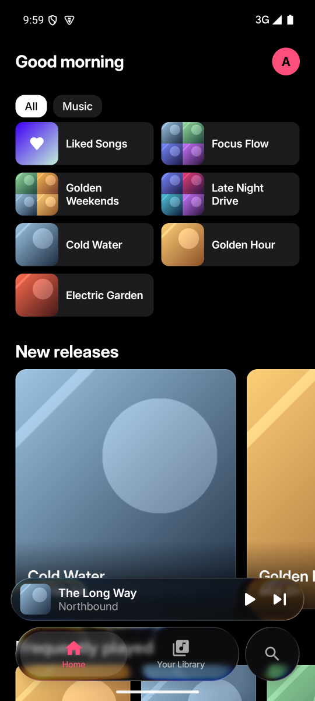
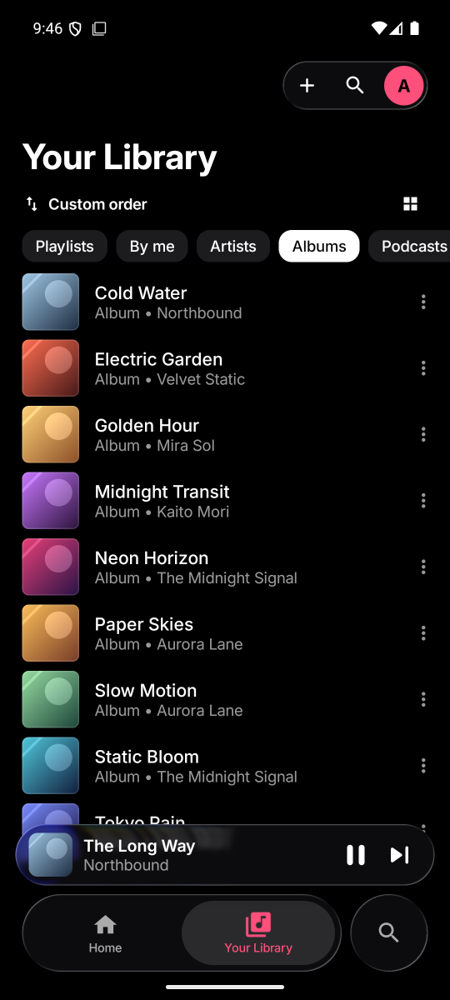
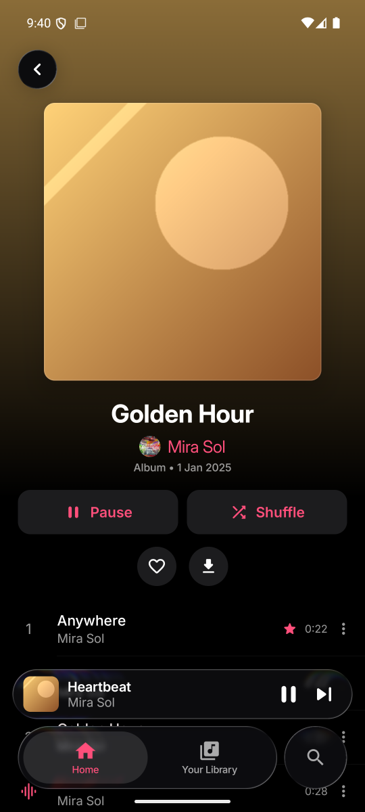
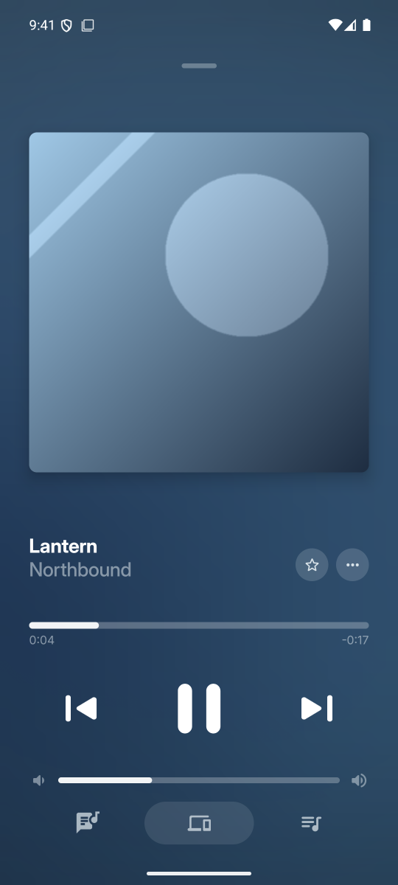
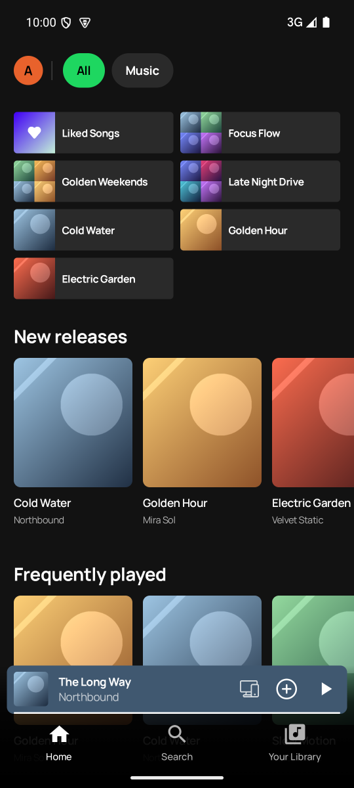
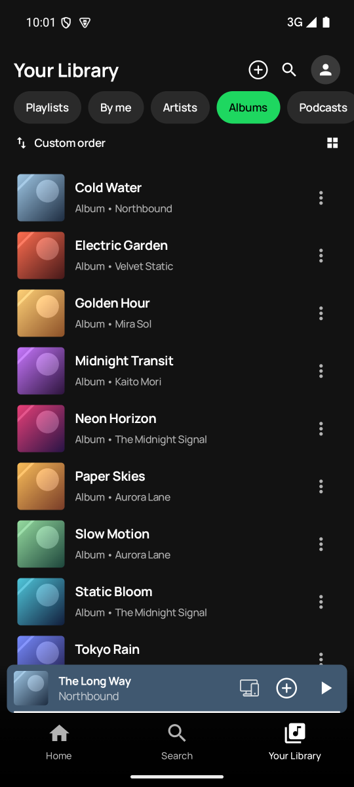
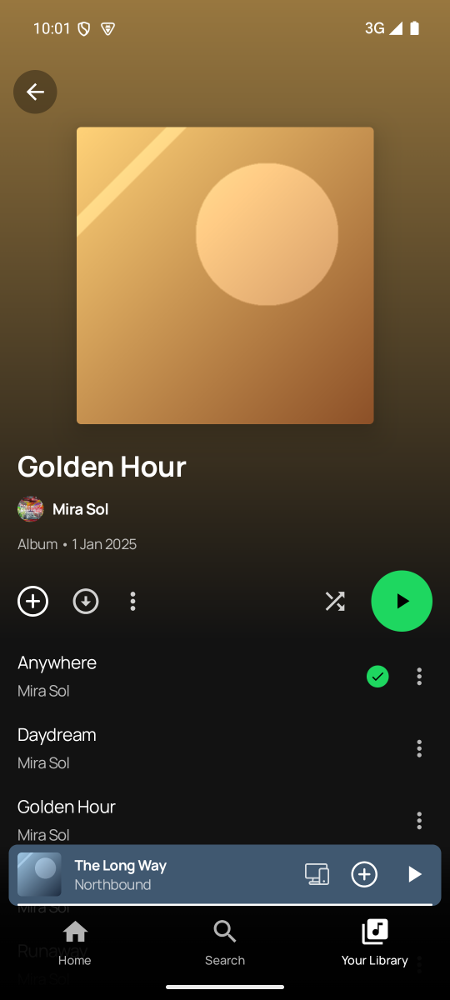
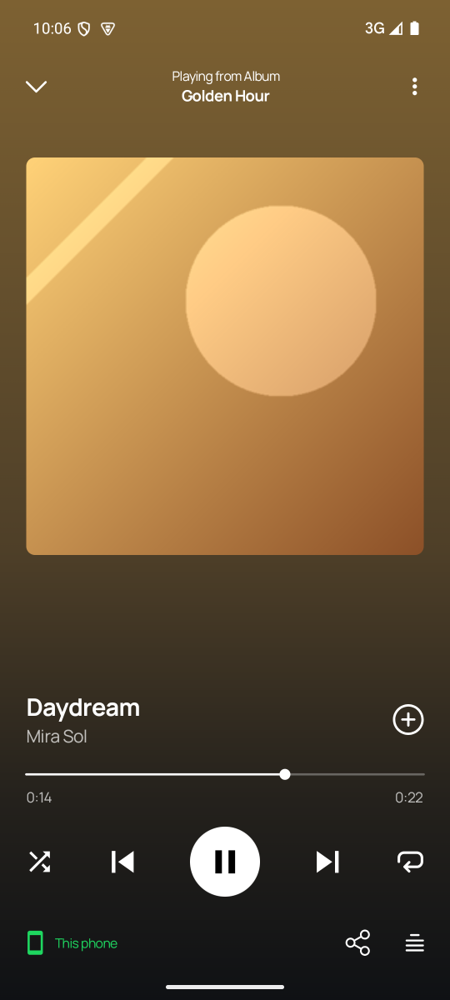

# Sonora

An Android **Subsonic / OpenSubsonic** music client for **Jellyfin (with Subfin)** and
**Navidrome**, built on the GPL-3.0 [Myspoti](https://github.com/kota-zo/myspoti) interface with
a native Subsonic backend (Media3 / ExoPlayer) in place of the Spotify Web Player.

Sonora is the app; your server is the source of truth. It speaks the Subsonic API (token auth),
so the same build works with Jellyfin/Subfin, Navidrome and other OpenSubsonic servers.

> **License: GPL-3.0.** See [`LICENSE`](LICENSE) and
> [`THIRD_PARTY_NOTICES.md`](THIRD_PARTY_NOTICES.md). Myspoti, Spotui, BitChord and the other
> upstream projects are credited there. The original Myspoti notices are kept in
> [`docs/upstream/`](docs/upstream/).

## Screenshots

Two looks ship in the same app: **Immersive** (the default: artwork forward, colours taken
from the cover) and **Classic** (dark player, round play button). Switch in
**Settings → Look**.

**Immersive**

| Home | Library | Album | Player |
|:--:|:--:|:--:|:--:|
| [](docs/screenshots/sonora/immersive-home.png) | [](docs/screenshots/sonora/immersive-library.png) | [](docs/screenshots/sonora/immersive-album.png) | [](docs/screenshots/sonora/immersive-player.png) |

**Classic**

| Home | Library | Album | Player |
|:--:|:--:|:--:|:--:|
| [](docs/screenshots/sonora/classic-home.png) | [](docs/screenshots/sonora/classic-library.png) | [](docs/screenshots/sonora/classic-album.png) | [](docs/screenshots/sonora/classic-player.png) |

Also: [Immersive search](docs/screenshots/sonora/immersive-search.png) ·
[Classic search](docs/screenshots/sonora/classic-search.png) ·
[Downloads and offline](docs/screenshots/sonora/immersive-downloads.png).

## What it does

- **Home, Search, Library, Album, Artist, Now Playing, Queue**, in two looks (Immersive by
  default, Classic in Settings → Look).
- **Playback** through Media3 `ExoPlayer`: gapless, seek, shuffle/repeat, background playback
  with a media notification, lock screen and headset/Bluetooth controls.
- **Your library's own data**: favourites (`star`), playlists (create, rename, add/remove,
  delete), recently played, artist biographies when the server provides them, lyrics
  (OpenSubsonic `getLyricsBySongId`, then `getLyrics`).
- **Server queue persistence** (`savePlayQueue` / `getPlayQueue`) and scrobbling
  (`nowPlaying`, then `submission=true` at half the song).
- **Downloads and offline** — the server's own files (original or transcoded: MP3 128, ≤320 kbps,
  or untouched), kept encrypted on the phone; offline, only downloads play and the lists say so.
  A WorkManager job keeps downloads going in the background.
- **Android Auto**: the car browses Home / Library / Downloads through the app's media browser
  service, and plays. The app is installed on the **phone**; Android Auto projects it.
- **Android Automotive OS** (the car runs Android itself) is a separate, optional build —
  see [`docs/TESTING.md`](docs/TESTING.md).

## Install

Releases are published on the [releases page](https://github.com/cherifad/sonora/releases).
Download `app-mobile-release.apk` and install it on the phone (Android 10+).

On first launch, enter the server URL and credentials:

- Jellyfin + Subfin: `http://<host>:8096/subfin/`
- Navidrome: `http://<host>:4533/`
- Emulator to the host machine: `http://10.0.2.2:4533/`

The server can be changed later from **Settings → Server** (or the profile menu).

## Build

JDK 17 and the Android SDK (platform 37) are required.

```bash
printf 'sdk.dir=/path/to/android-sdk\n' > local.properties

./gradlew :app:assembleDebug             # both flavors
# Phone/Android Auto APK: app/build/outputs/apk/mobile/debug/app-mobile-debug.apk
# Debug package:          com.adlen.sonora.dev

adb install -r app/build/outputs/apk/mobile/debug/app-mobile-debug.apk
```

Tests:

```bash
./gradlew :api-subsonic:testDebugUnitTest :app:testMobileDebugUnitTest   # JVM, no device
./gradlew :app:connectedMobileDebugAndroidTest \
  -Pandroid.testInstrumentationRunnerArguments.package=com.adlen.sonora.test.ui     # UI, on a device/emulator
```

## Branches and releases

- **`develop`** (default): all work; CI runs the JVM tests and builds the debug APKs.
- **`main`**: release-ready only, protected; a pull request from `develop`.
- A tag **`vX.Y.Z` on `main`** builds the signed APK and publishes a GitHub release.

See [`docs/RELEASING.md`](docs/RELEASING.md) for the secrets and the exact steps.

## Layout

```
app/            Compose UI (Myspoti fork)
api/            domain contract (SonoraApi, models)
api-subsonic/   Subsonic/OpenSubsonic backend + Media3 player
api-spotify/    upstream Spotify engine (kept for reference, never started)
host-android/   Android runtime (SonoraRuntime, playback service)
host-cdp/       upstream CDP tooling (reference)
extensions/     upstream extension sandbox (reference)
docs/           testing, releasing, Navidrome compatibility, screenshots
tools/          emulator, AVD and device scripts
```

The `api-spotify`, `host-cdp` and `extensions` modules are still compiled because the upstream
UI references them; the app itself only starts the Subsonic backend.

## Docs

- [`ROADMAP.md`](ROADMAP.md) — milestones.
- [`PORTING.md`](PORTING.md) — what the Subsonic port covers.
- [`docs/TESTING.md`](docs/TESTING.md) — emulators (phone, tablet, Wear, car), Android Auto.
- [`docs/RELEASING.md`](docs/RELEASING.md) — branches, tags, secrets.
- [`docs/NAVIDROME-COMPAT.md`](docs/NAVIDROME-COMPAT.md) — the client against Navidrome's API docs.

## Licence

GPL-3.0. If you distribute a binary, publish the complete corresponding source under GPL-3.0
and keep the notices. Sonora ships no Spotify assets and is not affiliated with Spotify,
Jellyfin or Navidrome.
