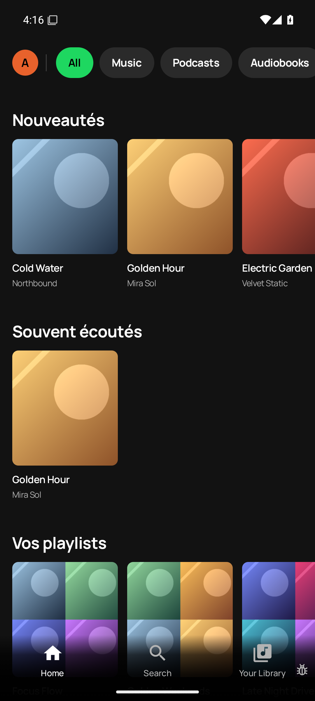
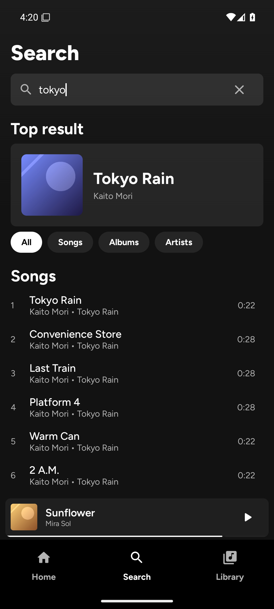
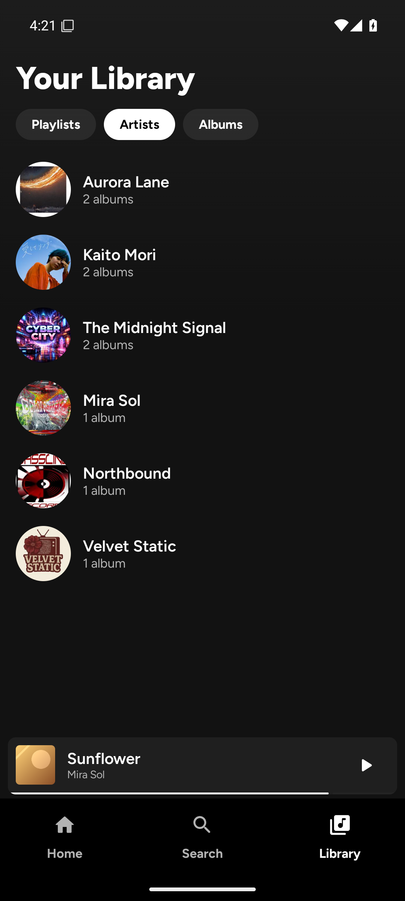
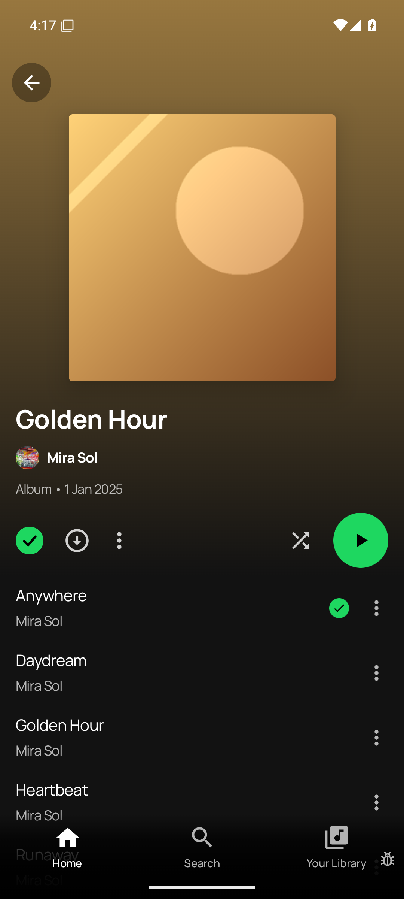
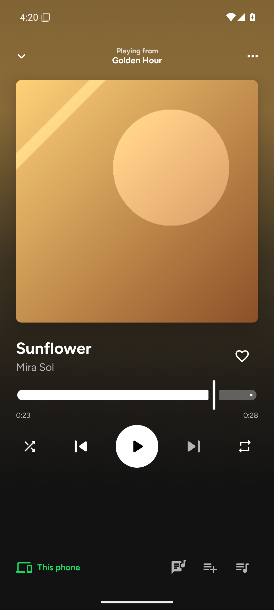

# Portage Subsonic — spike

Ce dépôt est un fork de [Myspoti](https://github.com/kota-zo/myspoti) (GPL-3.0) dont le
backend Spotify a été remplacé par un backend **Subsonic/OpenSubsonic** pour Jellyfin/Navidrome.

> **Licence** : ce fork reste sous **GPL-3.0**. Il conserve `LICENSE`, les en-têtes de
> copyright et la notice d'origine. Toute distribution doit fournir le code source complet
> sous GPL-3.0, conserver ces notices et créditer Myspoti. Voir `AGENTS.md`.

## Ce que fait le spike

| Surface | État |
|---|---|
| Démarrage sans login Spotify | Oui : `MyspotiRuntime.startSubsonic(...)`, le WebView n'est pas démarré |
| Home | Oui : nouveautés, souvent écoutés, playlists depuis Subsonic |
| Search | Oui : `search3` (morceaux/albums/artistes) + genres pour « Browse all » |
| Library | Oui : artistes, albums, playlists |
| Album | Oui : `getAlbum`, gradient, liste des morceaux |
| Artist | Partiel : `getArtist`, albums, top morceaux approximatif |
| Lecture | Oui : ExoPlayer + `stream.view`, file d'attente, pause/reprise/seek/next/previous |
| Playlists | Lecture oui ; création/édition non |
| Podcasts, Connect, Jam, Blends, Genius, Canvas, paroles, extensions, pubs/DRM | **Stubs / non portés** |

Le lecteur est un simple `ExoPlayer` dans le module `:api-subsonic` ; il n'y a plus de
WebView, de DRM Widevine ni de blocage de pubs.

## Architecture du portage

- `base/api-subsonic/` : nouveau module Android.
  - `SubsonicApi` implémente `MyspotiApi` (le contrat que toute l'UI Myspoti utilise déjà).
  - `SubsonicClient` : OkHttp + JSON, auth Subsonic `u/p` (mot de passe en clair pour le spike).
  - `SubsonicBackend` : `Home`, `Search`, `Catalog`, `Library`, `Playlists`, `Users` + stubs.
  - `SubsonicPlayer` : `app.myspoti.api.Player` au-dessus de Media3 `ExoPlayer`.
- `MyspotiRuntime` : ajoute `startSubsonic(...)` et `isSubsonic` ; `api` renvoie le backend
  Subsonic quand il est actif, sinon Spotify.
- `Graph.init` : démarre Subsonic à la place du Web Player.
- `MainActivity` : saute le login WebView en mode Subsonic.
- `SongPlayer` : en mode Subsonic, ne branche que les flux `player.state` / `player.queue`
  (pas de Connect, pubs, DRM, watchers Spotify).
- `AndroidManifest.xml` : `usesCleartextTraffic="true"` pour un serveur LAN en HTTP.

Les URI internes restent au format `spotify:track:<id>` / `spotify:album:<id>` : ce sont
des identifiants opaques pour l'UI Myspoti. Un nettoyage ultérieur peut les passer en
`subsonic:...`.

## Lancer

```bash
cd base
printf 'sdk.dir=/home/adlen/android-sdk\n' > local.properties
JAVA_HOME=/home/adlen/tools/jdk-17.0.20.1+1 ./gradlew :app:assembleDebug
adb install -r app/build/outputs/apk/debug/app-debug.apk
adb shell am start -n app.myspoti.dev/app.myspoti.MainActivity
```

Le serveur est lu dans les SharedPreferences `subsonic` :

```
url      = http://10.0.2.2:4533/   (10.0.2.2 = hôte depuis l'émulateur)
username = admin
password = admin
```

Valeurs par défaut dans `Graph.subsonicConfig`. Pour un vrai appareil, mettre l'IP du
serveur ou ajouter un écran de configuration.

## Prochaines étapes (pour un vrai port)

1. Écran de configuration serveur (URL, utilisateur, mot de passe) + auth par token `t/s`.
2. Remplacer/retirer les écrans et le code Spotify-only (Connect, Jam, Blends, podcasts,
   Canvas, Genius, extensions, pubs, DRM) — ils restent dans ce fork.
3. MediaSession + notification + lecture en arrière-plan (le spike n'a qu'un ExoPlayer
   en processus).
4. CRUD playlists, favoris, downloads/offline.
5. Renommer le package et retirer toute marque/asset Spotify avant distribution.
6. Tests : contrats Subsonic, mapping, player, écrans principaux.

## Captures

| Home | Search | Library |
|:---:|:---:|:---:|
|  |  |  |

| Album | Player |
|:---:|:---:|
|  |  |
